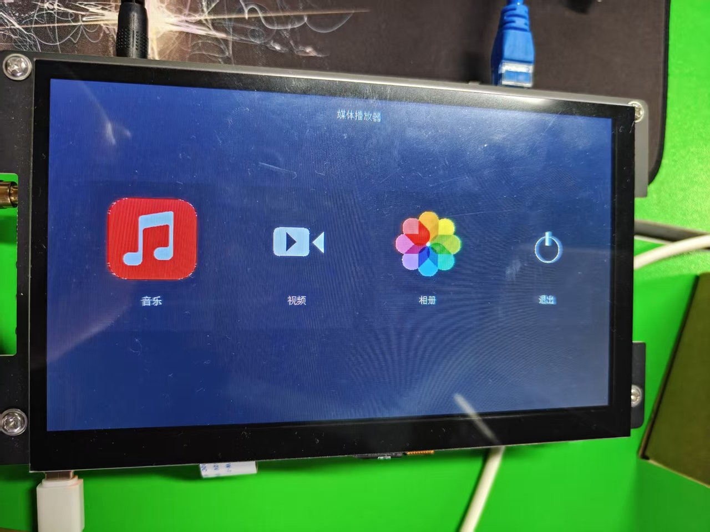
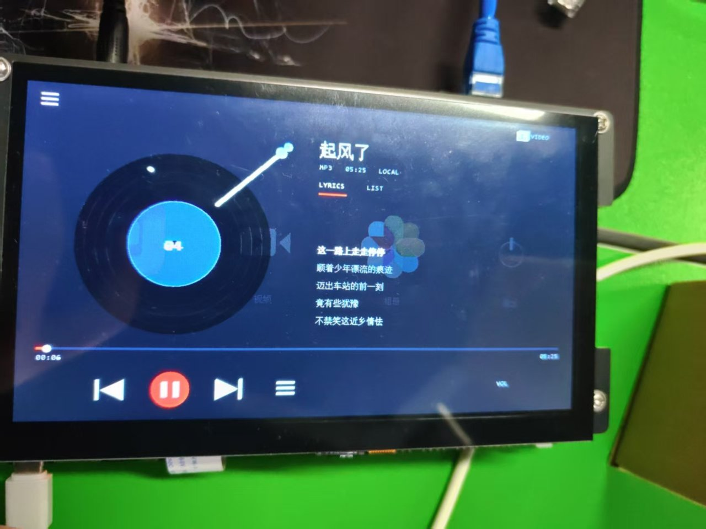
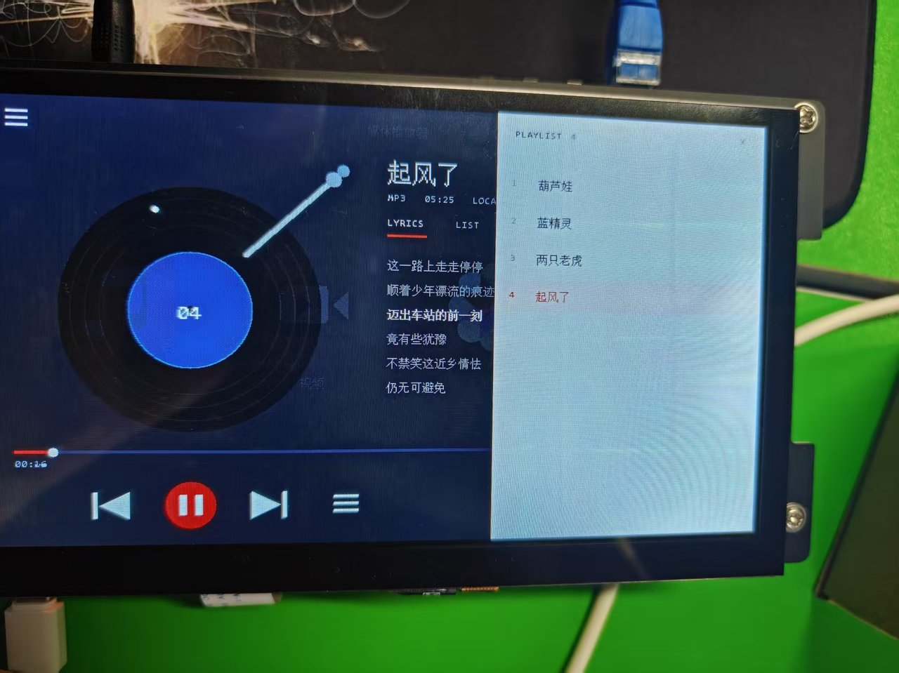
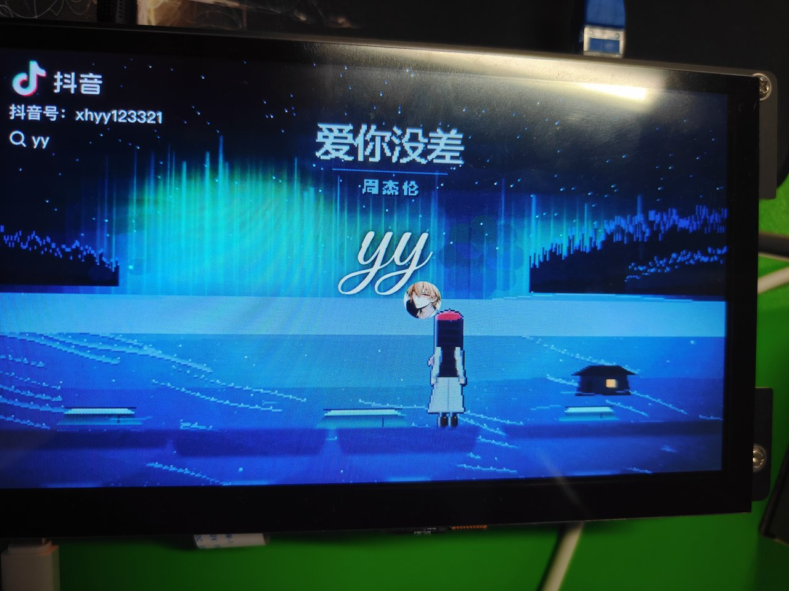
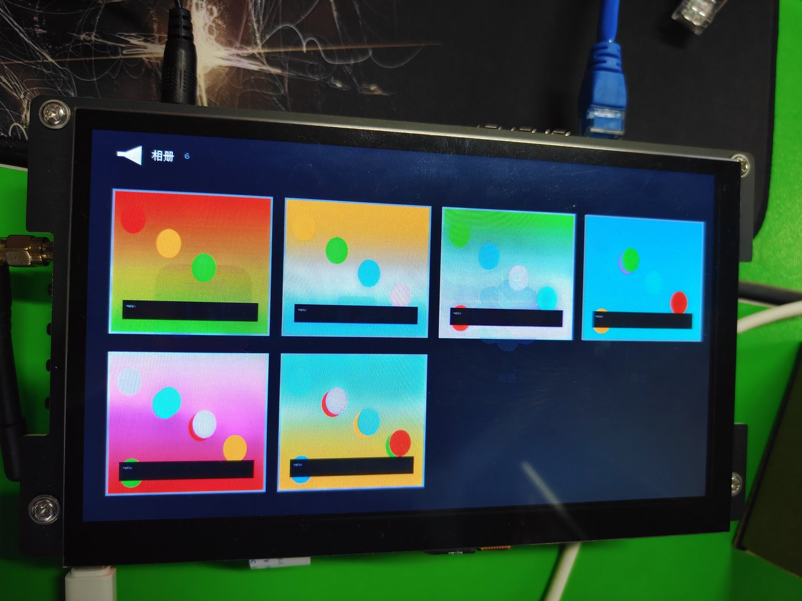
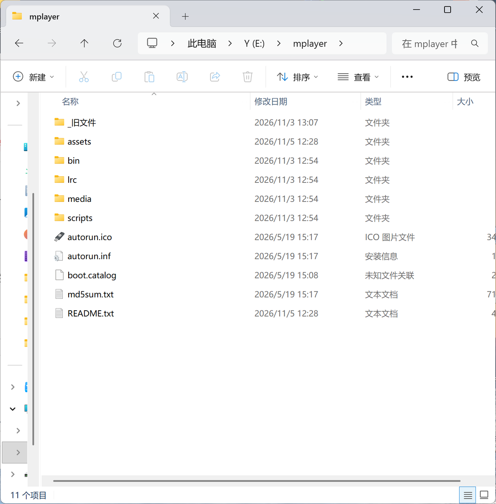

# RK3568 触摸屏多媒体播放器

> 一块 1024×600 电容触摸屏上的音乐 / 视频 / 相册三合一终端。
> C99 · Linux 系统编程 · **无 GUI 框架，帧缓冲逐像素自绘** · 交叉编译上板

-blue)


## 界面一览

| <br>**主启动器**：音乐 / 视频 / 相册 / 退出 | <br>**音乐页**：黑胶唱片 + LRC 歌词逐行高亮 |
|---|---|
| <br>**歌单侧栏**：点行切歌，当前行高亮 | <br>**视频全屏**：mplayer fbdev2 输出 |
| <br>**相册**：stb_image 缩略图网格 | <br>**U 盘安装包**：插盘一键安装 |

## 功能

| 模块 | 能力 |
|---|---|
| **音乐** | 播放/暂停（同键，图标随状态切换）、上一首/下一首、音量 ±（音量条 2 秒自动隐藏）、进度条点击 seek、歌单侧栏、LRC 歌词逐行高亮同步 |
| **视频** | mplayer fbdev2 全屏播放、触左边缘退出、播完自动回列表、退出后音乐自动恢复（假播修复） |
| **相册** | stb_image 解码 JPEG/PNG、缩略图网格、大图查看、左右滑动翻页 |
| **启动器** | 音乐 / 视频 / 相册 / 退出四磁贴入口 |
| **媒体管理** | readdir 自动扫描 `/ylh/media`（扩展名不分大小写）生成歌单与视频列表，中文歌名映射显示 |
| **系统** | 单实例保护（扫 `/proc` 精确排除自身）、开机自启（S99mp）、日志 1MB 轮转、md5 校验 OTA、SSH 运维通道 |
| **工业接口** | Modbus-RTU 从站（03/06 + CRC16 + 12 个保持寄存器 + FIFO/串口可插拔），上位机可读状态、写音量、发播放命令 |

## 工业接口：Modbus-RTU 从站

> 让播放器从"本地 UI 程序"变成"可被上位机 / HMI / PLC 监控与控制的设备"。
> 协议栈与传输层解耦：`modbus_rtu.c` 只认字节数组，`modbus_slave.c` 负责 FIFO / 串口。

**功能码**：03（读保持寄存器）、06（写单寄存器）；异常 01 / 02 / 03 / 06（06 = 从站忙）。

| 4xxxx | offset | 名称 | R/W | 说明 |
|---|---|---|---|---|
| 40001 | 0 | 协议版本 | R | `0x0100` = v1.0 |
| 40002 | 1 | 播放状态 | R | 0 停止 / 1 播放 / 2 暂停；写它回异常 02 |
| 40003 | 2 | 当前曲目 | R | 0-based，无效 `0xFFFF` |
| 40004 | 3 | 曲目总数 | R | `g_song_num` |
| 40005 | 4 | 当前秒 | R | 无效 `0xFFFF` |
| 40006 | 5 | 总秒 | R | 无效 `0xFFFF` |
| 40007 | 6 | 音量 | R/W | 0~100；>100 回 03 |
| 40008 | 7 | 命令 | W | 1 播放/暂停 2 下一首 3 上一首；读恒 0；写 0/>4 回 03；槽满回 06 |
| 40009 | 8 | 错误码 | R | 0 正常 / 1 mplayer 未运行 / 2 播放失败 |
| 40010 | 9 | 上电秒 低 16 位 | R | uptime low |
| 40011 | 10 | 上电秒 高 16 位 | R | uptime high；32 位字序 CDAB（主站 `high<<16 | low`） |
| 40012 | 11 | 命令接受计数 | R | 每接受一条命令 +1，模 65536 |

**调试帧（CRC 已核对）**

```
读 12 个寄存器 (FC03):  01 03 00 00 00 0C 45 CF
写音量 50       (FC06):  01 06 00 06 00 32 E8 1E
写命令=下一首    (FC06):  01 06 00 07 00 02 B9 CA
异常响应示例（非法功能码）：01 84 01 + CRC
```

**关键设计**

| 决策 | 原因 |
|---|---|
| 3.5 字符间隔参数化 | 9600 约 3.65ms、19200 约 1.82ms、>19200 规范固定 1.75ms；`select` 只做唤醒，时间戳用 `CLOCK_MONOTONIC` |
| 每帧快照 | 一次 FC03 读 12 个寄存器，所有值在同一时刻取齐，避免"当前曲目 5、总数却是 3"这类撕裂 |
| 单槽命令邮箱 + mutex | 协议线程只入队，主线程 `ui_ticker` 执行；槽满回 06、非法值回 03，不引入命令历史状态机 |
| 协议线程不碰 UI | 切歌会动 `g_song_cur` / 歌词，集中到主线程；协议线程临界区只有几微秒 |
| FIFO 用 `O_RDWR` 打开 | 自己既是读者也是写者：对端断开不会 `read()==0` 忙等，也不会 `O_WRONLY` 的 `ENXIO`；配合 `SIGPIPE` 忽略 |
| 精确帧长 | 03/06 请求固定 8 字节，多一少一都丢弃，避免尾字节污染下一帧 |

**测试证据**

- x86 单元测试：CRC 3 例 + 解析器 12 例（27 条断言）全过，`-Wall -Wextra -Werror` 零警告
- x86 FIFO 集成：读 12 个 / 写音量 / 坏 CRC / 写端断开重开 / 粘包，8 条断言全过
- 板上实测（RK3568）：`01 03 00 00 00 0C 45 CF` → 29 字节响应；两次 `next` 把曲目 0→2，状态变 PLAYING，错误码 0

**已知限制（v0.1）**

- 只实现 03/06；FC16 未实现，主站写多寄存器会收到异常 01
- 只在 FIFO 注入下验证，尚未接真实 UART / RS485 收发器 / PLC
- 站号固定 `0x01`、9600 8N1，无配置持久化
- 命令非幂等（播放/暂停切换、上下一首），主站不应盲目重试
- 未做 24h/48h 长稳、TSan、fuzz

## 架构

```
┌──────────────────────────────────────────────────────────────┐
│  应用层  stage4_main.c   启动器 / 音乐页 / 视频页 / 相册页     │
│          （SCR_LAUNCHER / SCR_MUSIC / SCR_VIDEO / SCR_ALBUM）  │
├──────────────────────────────────────────────────────────────┤
│  绘制层  fb_ui.c   mmap /dev/fb0                                │
│          渐变背景 / 圆与图标 / 区域快照恢复 / 中英点阵混排       │
│  资源    font16.c font_cn.c (自研点阵字库)  image.c (stb_image) │
├──────────────────────────────────────────────────────────────┤
│  业务层  mplayer_ctl.c   播放器从进程全生命周期管理             │
│          fork+execl │ FIFO 控制 │ pipe 解析 ANS │ SIGCHLD 回收 │
│          lrc.c  歌词时间轴    album.c  相册数据与手势           │
├──────────────────────────────────────────────────────────────┤
│  输入层  touch.c   /dev/input/eventN 触摸事件解码（ABS 坐标）   │
├──────────────────────────────────────────────────────────────┤
│  硬件    RK3568 · 1024×600 fb0 · 电容触摸 · mplayer64 后端      │
└──────────────────────────────────────────────────────────────┘
```

> 新增 `modbus_rtu.c` / `modbus_slave.c`：Modbus-RTU 从站，FIFO / 串口注入，协议与传输解耦。

### 关键设计决策

| 决策 | 原因 |
|---|---|
| **fork+execl 拉起 mplayer64 从进程**（而非嵌入 libmpv） | 板端只保证 mplayer 可用；进程隔离——播放器崩溃不拖垮 UI；mplayer `-slave` 模式提供稳定的文本控制协议 |
| **FIFO 下发控制 + pipe 解析 ANS 应答** | 全双工：命令走 FIFO，`ANS_PROGRESS/P_TIME_LENGTH` 走 pipe；避免单一通道读写互锁 |
| **SIGCHLD + waitpid 循环回收** | 消除僵尸进程；回调里触发自动连播（下一首/回列表） |
| **三级退场 quit → SIGTERM → SIGKILL** | 优雅切歌：先让 mplayer 自己退出，超时升级信号，杜绝残留孤儿 |
| **播放代际号 `g_gen`** | 子进程事件是异步的，用代际号丢弃上一轮迟到事件，修复"视频刚进就退""退出后假播"两类竞态 |
| **静态链接（aarch64 -static）** | 板端 rootfs 库版本不确定，静态链接消灭一类"上板不跑"问题 |
| **单实例保护：扫 `/proc` 按 pid 排除自身** | 多实例抢同一 framebuffer 会互相覆盖画面（实测"抽搐"）；`killall` 按名字会连自己一起杀 |
| **UI 绘制线程与业务线程分离 + 互斥锁** | 进度/歌词 500ms 刷新与触摸事件解耦；锁只包绘制区间 |
| **Modbus 协议栈与传输解耦** | `modbus_rtu.c` 只认字节数组（可 x86 单测），`modbus_slave.c` 负责 FIFO/串口；换 UART 不动协议层 |
| **每帧快照 + 单槽命令邮箱** | 一帧内 12 个寄存器值同一时刻取齐；命令由主线程执行，协议线程不碰 UI 状态 |

## 自研点阵字库工具链

板端没有字体库，方案是**自己做字库**（`gen_font16.py` / `gen_cn_font.py`）：

- ASCII：Consolas 13px → 8×16 点阵 → `font16.c`
- 中文：SimSun 16px → 16×16 点阵 → `font_cn.c`（只内嵌用到的字，几 KB）
- 运行时 UTF-8 动态解码 → 码点二分查找 → 双放大（scale）绘制
- 新歌词/新界面文字：改字表重跑脚本即可，`-Wall` 零警告

## 快速开始

### 1. 交叉编译（VM / PC，需 aarch64-linux-gnu-gcc）

```sh
bash build.sh          # 产出 build/：ARM 静态可执行 + md5
```

产物：`stage1_console`（控制层验证）/ `stage2_player`（分层版）/ `stage3_ui`（触摸 UI）/ `media_player`（完整应用）/ `touch_test`（触摸探针）/ `stage2_player_x86`（VM 逻辑调试）。

### 2. 部署（三选一）

| 方案 | 适用 | 命令 |
|---|---|---|
| **SSH（日常最快）** | 板子与 PC 网线直连 | `scp build/media_player rkboard:/ylh/ && ssh rkboard /etc/init.d/S99mp restart` |
| **HTTP + md5 校验（OTA 式）** | 不想动 SSH | 板子：`sh /ylh/pull.sh`（拉取→校验 md5→替换→重启服务） |
| **U 盘安装包** | 答辩现场 / 新板子 | 板子：`sh /media/sda1/mplayer/scripts/install.sh` |

### 3. 开机自启（S99mp，busybox init）

`/etc/init.d/S99mp`：等待 `/dev/fb0` 与触摸设备就绪（最多 10s）→ 日志轮转 → 拉起播放器。
手动管理：`/etc/init.d/S99mp start | stop | restart`。

## 媒体目录约定

```
/ylh/media/
├── huluwa.mp3  lanjingling.mp3  liangzhilaohu.mp3  qifengle.mp3   # 音频
├── *.lrc        # 同名歌词（[mm:ss.xx]逐行），可选
└── 1.mp4        # 视频
```
文件名任意、扩展名不分大小写；放进去重启即生效。

## 踩坑精选（面试素材）

| 现象 | 根因 | 对策 |
|---|---|---|
| 界面画了但屏幕不变 | RK fbdev 双缓冲，控制台 pan 在第 2 块缓冲 | `FBIOPUT_VSCREENINFO` 强制 `yres_virtual=yres, yoffset=0`；失败则按 yoffset 定位绘制 |
| 界面被开机 logo 挡住 | 屏上电显示 boot logo 占显示通道 | `FBIOBLANK(UNBLANK)` 程序内自动接管 |
| 多实例画面"抽搐" | 两个实例各画各的 | 单实例保护（`/proc` 扫描，按 pid 排除自身） |
| 加上单实例保护后程序秒退 | `killall media_player` 把还活着的自己杀了 | 改 C 实现：`kill(pid)` 逐个杀，跳过 `getpid()` |
| 视频刚进就退 / 退出后假播 | SIGCHLD 事件跨轮次串台（异步竞态） | 播放代际号，旧代事件直接丢弃 |
| 串口传大文件总在中途失败 | RK 内核 FIQ 调试器会被串口毛刺触发接管控制台（提示符 `debug>`） | `console` 命令切回；生产改走网线 HTTP/SSH |
| 串口粘贴长命令内容丢失 | 1500000 波特率下粘贴掉字节 | 长内容不粘贴：wget 拉脚本/公钥，短命令操作 |
| 视频播放时进度条闪烁 | ticker 在视频态仍重绘 | 切页前先置 `SCR_VIDEO` + `g_video_playing` 门禁 |
| Modbus 一次读 12 个寄存器数值互相矛盾 | 每个 read 回调各取一次，UI 线程中途切歌 | 每帧开始拷一份 snapshot，所有 read 从快照取 |
| 主站一断开播放器就退出 | 写已关闭的 FIFO 触发 `SIGPIPE` | 忽略 `SIGPIPE`；FIFO 用 `O_RDWR` 打开，避免 EOF 忙等与 ENXIO |
| 115200 下两帧被当成一帧 | 固定 5ms 判帧不适用于高波特率 | 判帧间隔按波特率算（>19200 固定 1.75ms）；03/06 请求精确 8 字节 |

## 规模

- 自写代码 **≈ 4100 行**（C99，`-Wall` 零警告；不含第三方 stb_image 8000 行）
- 产物：静态可执行 6.2 MB（含字库与 stb_image）
- Git 历史 10+ commit（feat/fix/docs 规范前缀），双远端同步：GitHub + Gitee

## 目录

```
├── build.sh              一键交叉编译（ARM 静态 + x86 调试 + md5）
├── gen_font16.py         ASCII 点阵字库生成器
├── gen_cn_font.py        中文字库生成器（读 lrc/ 与界面字表）
├── lrc/                  歌词样例
├── src/
│   ├── common.h          常量与媒体目录
│   ├── mplayer_ctl.[ch]  控制层：从进程 + FIFO/pipe + SIGCHLD + 代际号
│   ├── fb_ui.[ch]        绘制层：mmap fb、图形、点阵混排、区域快照
│   ├── touch.[ch]        输入层：/dev/input/eventN
│   ├── lrc.[ch]          歌词解析
│   ├── modbus_rtu.[ch]   Modbus-RTU 协议栈（CRC16 / 03 / 06 / 异常）
│   ├── modbus_slave.[ch] 接入层（FIFO 线程 / 每帧快照 / 命令邮箱）
│   ├── image.c / album.c 相册（stb_image 解码、缩略图、手势）
│   ├── font16.c/font_cn.c 自研点阵字库
│   ├── stage1_console.c  阶段 1：控制层验证
│   ├── stage2_player.c   阶段 2：分层版（x86 可编译）
│   ├── stage3_ui.c       阶段 3：基础触摸 UI
│   └── stage4_main.c     阶段 4：完整应用
├── deploy/
│   ├── pull.sh           md5 校验 OTA 拉取
│   ├── S99mp             开机自启（设备就绪等待 / 日志轮转）
│   ├── install.sh        U 盘一键安装
│   └── README_USB.txt    U 盘包说明
├── docs/screenshots/     界面截图
└── tests/                Modbus 单测（CRC / 解析）+ FIFO 集成测试
```

## 许可

课程结课项目，仅供学习交流参考。
